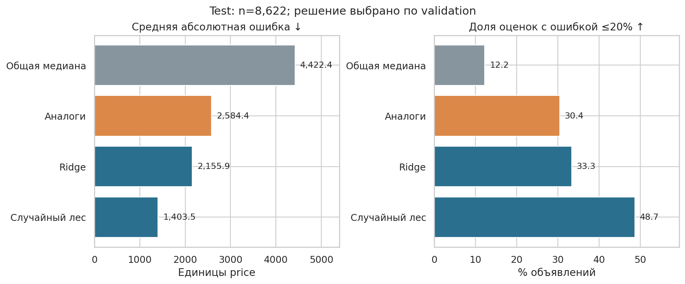
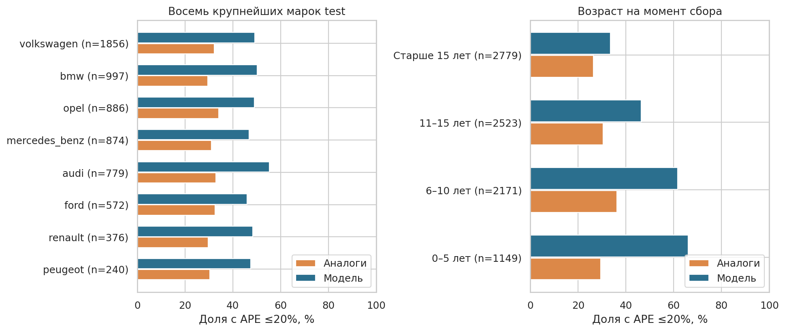
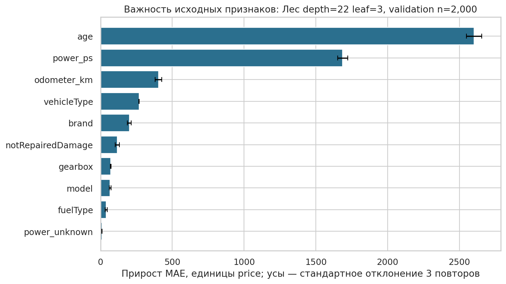

# Оценка цены автомобиля

Сравнил Ridge и случайный лес с медианой похожих объявлений. Проверил, насколько точно
можно оценить запрашиваемую цену по характеристикам машины. Результат может служить
продавцу ориентиром при публикации объявления.

Учебный анализ 50 000 объявлений eBay Kleinanzeigen из Германии за 5 марта – 7 апреля
2016 года на [выборке Dataquest](https://www.dataquest.io/blog/cleaning-and-analyzing-used-car-listings-from-ebay-kleinanzeigen/).
В `price` указана цена объявления, а не завершённой сделки. Валюта учебной копии
не установлена, поэтому цены и MAE приведены в единицах этого поля.

## Данные и модели

По заголовкам исключил 40 предложений явной скупки или переуступки лизинга.
Из них 13 проходили числовые фильтры цены и года регистрации. Обычные продажи
с упоминанием лизинга сохранил. После очистки осталось 43 126 объявлений
с ценой от 500 до 50 000 и годом регистрации от 1886 до 2016.
Мощность вне 20–600 PS заменил пропуском с отдельным флагом.

Модели используют возраст, пробег, мощность, марку, модель, кузов, коробку передач,
топливо и сведения о ремонте. Медиана аналогов учитывает марку, модель и возраст;
при нехватке объявлений берёт более общую группу.

Разделил объявления на train, validation и test: 25 876, 8 628 и 8 622 строк.
Похожие повторные объявления по составному ключу оставил в одной части.
Параметры и модель выбрал по минимальной MAE на validation, затем переобучил
финалистов на train + validation и оценил на test. Пропуски и категории обрабатываются внутри Pipeline.

## Результаты

На выборке после очистки RandomForest снизил MAE относительно медианы аналогов
на **45,7%**, или 1 180,9 единицы цены. Доля прогнозов с относительной ошибкой
не больше 20% выросла с **30,4% до 48,7%**, на 18,3 п.п.

| Метод | MAE на test | Медианная абсолютная процентная ошибка | Доля с ошибкой ≤20% |
| --- | --- | --- | --- |
| Общая медиана | 4 422,4 | 69,1% | 12,2% |
| Медиана аналогов | 2 584,4 | 35,0% | 30,4% |
| Ridge, α=10 | 2 155,9 | 30,4% | 33,3% |
| RandomForest | 1 403,5 | 20,7% | 48,7% |

У выбранного леса 160 деревьев, максимальная глубина 22 и минимум 3 объявления
в листе. Порог ошибки 20% использую как ориентир точности.

Лес можно рассматривать как основу ценовой подсказки. Для оценки её качества
на текущем рынке нужны свежие объявления: расчёт выполнен на данных 2016 года.

## Ошибки по сегментам

Среди возрастных групп наибольшая доля прогнозов с ошибкой до 20% у машин
0–5 лет: **66,1%** на 1 149 объявлениях. У машин старше 15 лет она составляет
**33,5%** на 2 779 объявлениях. Сравнивал сегменты минимум со 100 объявлениями.

В ценовом диапазоне 500–1 999 средняя ошибка леса равна 507,0, но лишь 35,7%
прогнозов укладываются в 20% от цены, n=2 866. Ценовые группы построены по фактической
цене только для разбора ошибок. Все срезы сохранены в [таблице сегментов](reports/segment_errors.csv).

## Важность признаков

Перемешивание возраста и мощности увеличило MAE на 2 601,2 и 1 686,8 соответственно
на 2 000 объявлениях validation. Это зависимость качества прогноза от признаков.

Расчёты и выводы: [analysis.ipynb](analysis.ipynb). Для повторения выполните все ячейки
по порядку. Зависимости указаны в [requirements.txt](requirements.txt).

Стек: Python, pandas, NumPy, scikit-learn, Matplotlib, Seaborn, Jupyter.
