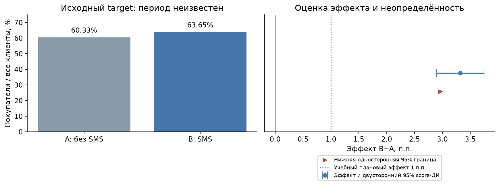
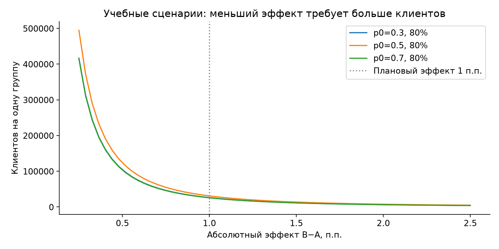
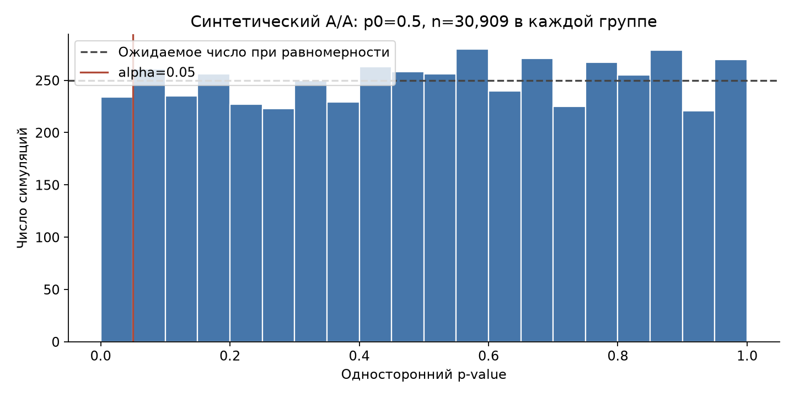
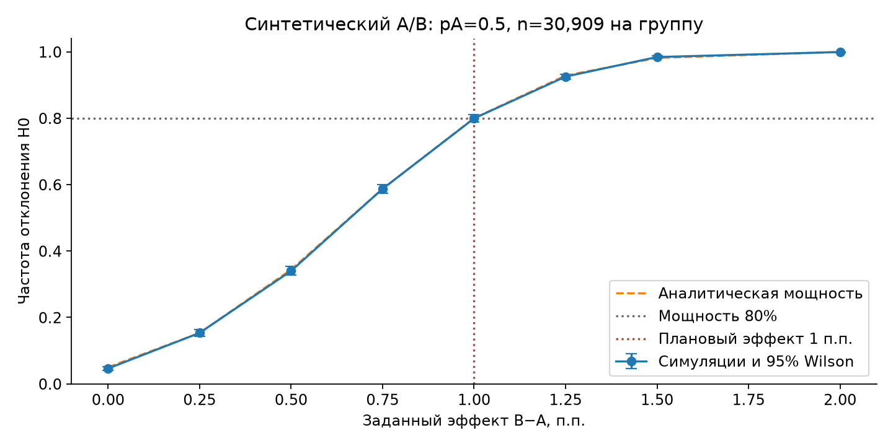
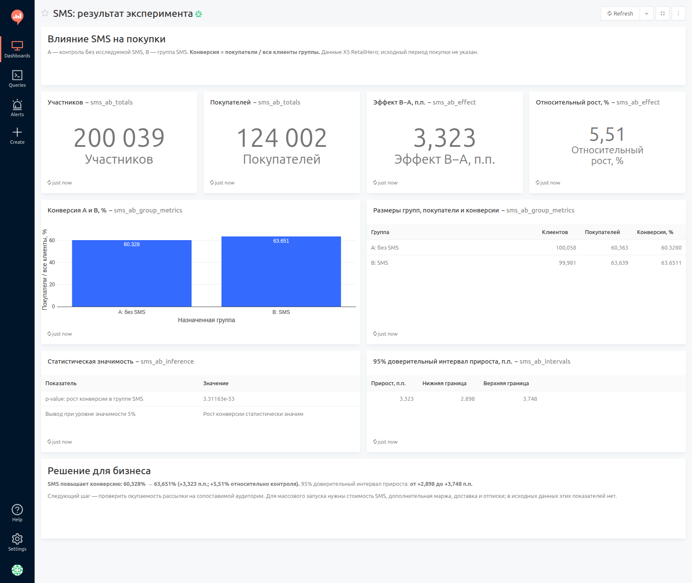
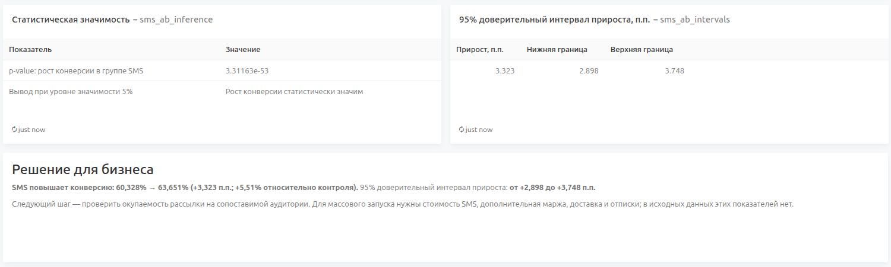

# Анализ A/B-теста SMS-рассылки

Сравниваю конверсию в покупку у клиентов в группе SMS-рассылки и контрольной группы. Проверяю, повышает ли коммуникация вероятность покупки и есть ли основания для дальнейшей рассылки.

Учебный анализ завершённого эксперимента на открытых данных [X5 RetailHero](https://ods.ai/competitions/x5-retailhero-uplift-modeling/data). В выборке 200 039 клиентов. Метрика — доля покупателей среди всех клиентов группы; исходный период покупки в данных не указан.

## Результаты

Проверил данные, сравнил конверсии односторонним z-тестом и рассчитал доверительные границы разницы B−A. Пропусков и повторов клиентов нет, в анализ вошла вся выборка.

| Группа | Клиентов | Покупателей | Конверсия |
|---|---:|---:|---:|
| A: контроль | 100 058 | 60 363 | 60,328% |
| B: SMS | 99 981 | 63 639 | 63,651% |

Конверсия в группе SMS выше на **3,323 п.п.**, относительный рост — **5,51%**. Различие статистически значимо при alpha=0.05: односторонний p-value **3,31×10⁻⁵³**. Двусторонний 95% score-ДИ эффекта — **[2,898; 3,748] п.п.**, нижняя односторонняя 95% граница — **2,966 п.п.**

Результат поддерживает дальнейшую проверку SMS на сопоставимой аудитории. Для решения о массовой рассылке нужны стоимость коммуникации, дополнительная маржа, отписки и доставка — этих данных в файле нет.

Конверсии групп и доверительные границы эффекта B−A:



## Выборка и проверка метода

Для учебного сценария с базовой конверсией 50%, эффектом +1 п.п., alpha=0.05 и мощностью 80% рассчитал **30 909 клиентов на группу**. При доступных размерах реальных групп обнаружимый эффект для того же сценария составляет **0,556 п.п.** Параметры планирования описаны в [дизайне эксперимента](experiment_design.md).



Проверил критерий в 5000 синтетических A/A и 5000 A/B на каждый заданный эффект. В A/A доля ложных срабатываний составила **4,68%** при alpha=5%, 95% интервал Wilson — **[4,13%; 5,30%]**.



При плановом эффекте +1 п.п. эмпирическая мощность **79,94%** близка к аналитическим **80,00%**; интервалы на графике показывают неопределённость симуляций:



## Redash

В Redash оставлен один бизнес-дашборд — [«SMS: результат эксперимента»](http://127.0.0.1:5055/dashboards/1-sms-): участники, покупатели, конверсии, абсолютный и относительный прирост, значимость, 95% доверительный интервал и решение для команды. Планирование выборки и симуляции представлены в ноутбуке.

Скриншот действующего дашборда:



Статистическая оценка и решение для бизнеса крупнее:



## Анализ и запуск

Основной анализ — в [sms_ab_analysis.ipynb](sms_ab_analysis.ipynb). Стек: Python, pandas, NumPy, SciPy, statsmodels, Matplotlib, PostgreSQL и Redash.

Открыть ноутбук в подготовленном окружении:

```bash
.venv/bin/python -m jupyterlab sms_ab_analysis.ipynb
```

Установка зависимостей, загрузка результатов в PostgreSQL и сборка дашборда через интерфейс Redash описаны в [инструкции запуска](redash_setup.md).

- [sms_ab_analysis.ipynb](sms_ab_analysis.ipynb) — полный анализ с сохранёнными выводами и графиками.
- [figures/](figures/) — графики анализа и скриншоты Redash.
- [results/](results/) — расчётные таблицы, параметры анализа и отчёты проверок.
- [scripts/load_postgres.py](scripts/load_postgres.py) — загрузка клиентов и расчётных таблиц в PostgreSQL.
- [sql/](sql/) — схема данных и SQL-запросы; пять запросов используются бизнес-дашбордом, остальные относятся к планированию и проверке метода.
